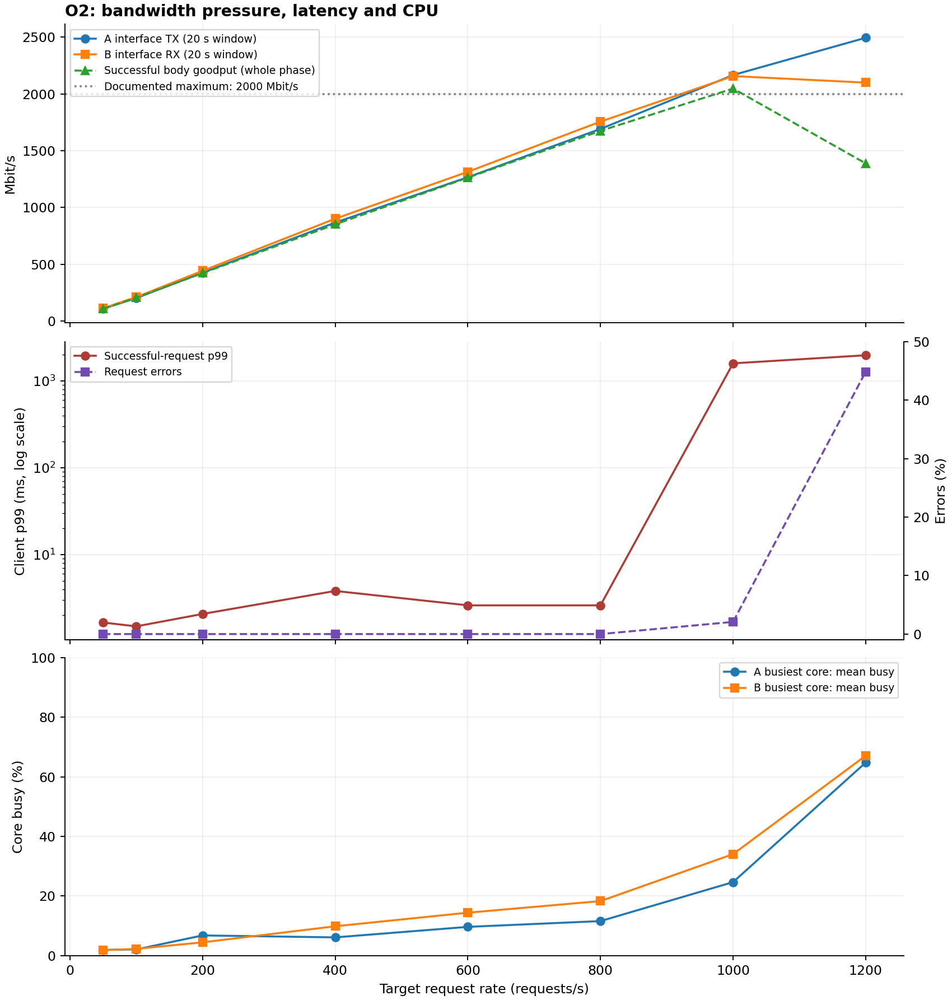

# 实验 2 记录：第 9 组

评分时依据本文件和 `runs/` 中的原始数据核对。本文件中的每一个数值，都须能在某个 `runs/<名字>/` 的文件中找到：表格用 `scripts/table.sh` 生成后粘贴，其他数值注明出处（例如“`runs/r1-pool4/red.csv` 第 6 阶段”）。不要只贴截图。将 `<填写>` 替换为本组的内容。

第 4.1、4.4、5.1、5.3 节的预测须在对应的测量之前写好，写好后不要修改。预测错误不扣分，与实测不一致之处在分析中讨论。

## 1. 基本信息

| 项 | 内容 |
|---|---|
| 小组 | 第 9 组 |
| 仓库地址 | <https://github.com/Qiyao-25/ops-lab2-9> |
| 主机 | 华为云弹性云服务器 ECS；规格 `x1.2u.4g`，2 vCPU、4 GB；华东-上海一，可用区3（`cn-east-3c`）；系统可见内存 3531 MiB |
| CPU | x86_64，GenuineIntel，General Purpose Processor；2 vCPU（0、1）；CPU 0、1 的 SOCKET 均为 0，CORE 均为 0 |
| 内存 | `free -m`：total 3531 MiB，available 2894 MiB；Swap 0 MiB |
| 数据目录所在的盘 | 华为云 EVS 通用型 SSD 系统盘，40 GB，非共享盘；`data/` 位于 `/dev/vda1`，ext4，挂载点 `/`；所属块设备 `vda`，非 tmpfs |
| 操作系统与内核 | Ubuntu 24.04.4 LTS；Linux 6.8.0-136-generic |
| Go、Prometheus、node_exporter | Go 1.26.9 linux/amd64；Prometheus 3.13.4；node_exporter 1.12.1 |
| 分核 | enrolld：CPU 1（`taskset -c 1`）；loadgen、Prometheus、node_exporter：CPU 0（`GEN_CPUS=0`，启动时绑定 CPU 0） |

基本信息来源：`runs/task0-baseline/host-info-excerpt.txt`（用户提供的终端输出节选）；仓库地址和工具版本由本次服务器核对，见 `runs/task0-baseline/versions.txt`。

云平台实际配置来源：`runs/task0-long-observation-20261028T170540Z/console-config.txt`（已登录控制台读取字段）和 `cloud-selected.json`（仅保留规格、区域等非敏感元数据字段）。控制台标称内存 4 GB 与 `free -m` 可见的 3531 MiB 分别按各自来源记录。虚拟磁盘的 `ROTA` 值不作为云盘介质判断依据。

分核限制：虚拟机呈现的 CPU 0、1 具有相同的 SOCKET 和 CORE，`lscpu` 显示每核 2 个线程，因此无法按该拓扑将压测程序与服务分配到不同物理核。仍按指导书的 2 vCPU 方案绑定两个逻辑 CPU，但二者可能争用底层执行资源。虚拟机呈现的拓扑不一定代表宿主机的实际分配，分析结果时需说明这一限制。

## 2. 任务 0：基线

`bin/enrolld -bench-fsync 2000` 连续运行三次的输出：

```text
fsync 次数 2000，总耗时 2.56 s，数据目录 data
fsync 耗时（毫秒）：mean 1.274  p50 1.218  p90 1.401  p99 2.554  max 10.680
按平均值推算，一个写者串行 fsync 每秒最多约 785 次（= 1000 / 1.274）
fsync 次数 2000，总耗时 2.61 s，数据目录 data
fsync 耗时（毫秒）：mean 1.300  p50 1.229  p90 1.452  p99 2.553  max 8.828
按平均值推算，一个写者串行 fsync 每秒最多约 769 次（= 1000 / 1.300）
fsync 次数 2000，总耗时 2.54 s，数据目录 data
fsync 耗时（毫秒）：mean 1.265  p50 1.206  p90 1.412  p99 2.468  max 5.339
按平均值推算，一个写者串行 fsync 每秒最多约 790 次（= 1000 / 1.265）
```

按平均值计算，三次分别约为 785、769、790 次/秒。三次各测试 2000 次，平均耗时的算术平均为 `(1.274 + 1.300 + 1.265) / 3 = 1.279667 ms`，据此单个写者串行 fsync 每秒最多约 **781 次**（`1000 / 1.279667`）。三次平均耗时范围为 1.265～1.300 ms，最大差值为 0.035 ms，相对于最小值约为 2.77%；输出的串行上限范围为 769～790 次/秒，相差 21 次/秒。上述上限只是基于 fsync 基线的推算，实际服务吞吐还包含 HTTP 处理、排队和运行时等开销。

数据来源：`runs/task0-baseline/fsync-bench.txt`，为用户提供的三次终端输出转录，未重新运行测试，也未修改测量数值。

空载和运行 fsync 测试时各工具的读数（补测：两种状态均选取连续 10 个一秒采样区间，取值范围如下）：

| 工具与列 | 空载 | 运行 `-bench-fsync` 时 | 该列的含义 |
|---|---|---|---|
| `vmstat -w -t 1`：r、b | r = 0，b = 0 | r = 0～3，b = 0～1 | r：运行或等待 CPU 的任务数，属于瞬时采样值；b：不可中断睡眠任务数，常见于等待 I/O |
| `vmstat -w -t 1`：us、sy、id、wa、st | us = 0～1%，sy = 0～1%，id = 99～100%，wa = 0～1%，st = 0% | us = 1～2%，sy = 2～5%，id = 48～50%，wa = 46～47%，st = 0% | us、sy：用户态和内核态 CPU 时间比例；id：空闲比例；wa：有未完成磁盘 I/O 时的 CPU 空闲比例；st：被宿主机占走的 CPU 时间比例；均为全机汇总值 |
| `iostat -dx -t 1 vda`：w/s、wkB/s | w/s = 0～4，wkB/s = 0～124 | w/s = 2258～2360，wkB/s = 12332～12912 | 每秒完成的设备写请求数、每秒写入的 KiB；包括文件系统及后台写入，不等于应用记录数 |
| `iostat -dx -t 1 vda`：w_await、f/s、f_await | w_await = 0～1.00 ms，f/s = 0～2，f_await = 0.00 ms | w_await = 0.41～0.43 ms，f/s = 1505～1573，f_await = 0.03～0.04 ms | w_await：写请求平均耗时（含排队）；f/s：每秒 flush 请求数；f_await：flush 平均耗时（含排队）；显示 0.00 可能是无请求或低于显示精度 |
| `iostat -dx -t 1 vda`：aqu-sz、%util | aqu-sz = 0.00，%util = 0～0.10% | aqu-sz = 1.02～1.03，%util = 94.70～97.30% | aqu-sz：平均未完成 I/O 请求数（含处理及排队）；%util：存在未完成 I/O 的时间比例 |

运行 fsync 测试时，CPU **不繁忙**：所选 10 个负载样本的 `us + sy` 为 3%～7%，而 `wa` 为 46%～47%。`r` 偶尔采到 3 是瞬时现象，不能单凭一次读数判定 CPU 已饱和；结合较低的 CPU 计算占用，可判断主要成本在磁盘同步等待。相较空载，`b` 出现 1，说明存在不可中断睡眠的任务。

磁盘等待的证据还包括 `aqu-sz = 1.02～1.03`、`w_await = 0.41～0.43 ms` 和 `f_await = 0.03～0.04 ms`。同时 `%util` 达到 94.70%～97.30%，写请求为 2258～2360 次/秒，flush 为 1505～1573 次/秒，说明磁盘在持续处理同步写产生的 I/O。`aqu-sz` 包含正在处理的请求，不能全算作排队；`%util` 接近 100% 不能单独证明云盘吞吐上限。底层写请求、flush 与应用 fsync 不一一对应，设备 await 也不能直接替代应用 fsync 耗时。

补测命令与结果（2026-10-29，北京时间）：

```bash
vmstat -w -t 1
iostat -dx -t 1 vda
bin/enrolld -bench-fsync 20000
```

```text
fsync 次数 20000，总耗时 25.84 s，数据目录 data
fsync 耗时（毫秒）：mean 1.286  p50 1.212  p90 1.469  p99 2.808  max 14.692
按平均值推算，一个写者串行 fsync 每秒最多约 777 次（= 1000 / 1.286）
```

本次补测用 20000 次保证 fsync 负载持续超过 10 秒：程序报告总耗时 25.84 秒，外层记录执行约 25.858 秒；原先的三次 2000 次基线和原始输出全部保留。补测均值 1.286 ms 及其约 777 次/秒的串行上限仅作为补充对照，不替换前文三次基线推算。

取样与证据：

- 原始输出和时序位于 `runs/task0-long-observation-20261028T170540Z/`：`vmstat.log`、`iostat.log`、`bench.txt`、`observation.json` 及两个 `*-timing.jsonl`。监控先记录约 14 秒空载，再执行基准，基准结束后继续记录约 3 秒。`observation.json` 保存真实执行命令、开始/结束时间和返回值。
- `selected-samples.csv` 是从原始日志派生的取样索引，标明工具、状态、样本序号、原始文件行号及接收时间；原始日志保持不变。两个工具首组开机以来平均值均排除；打印重复表头不代表重启。
- 空载均取从监控启动约 2 秒后开始的连续 10 个一秒区间；vmstat 对应 `vmstat.log` 第 5～14 行，iostat 对应 `iostat.log` 第 15、20、25、30、35、40、45、50、55、60 行。
- 负载均取基准启动约 2 秒后开始的连续 10 个一秒区间，约为北京时间 01:05:56～01:06:06；vmstat 对应 `vmstat.log` 第 20、21、22、23、26、27、28、29、30、31 行，iostat 对应 `iostat.log` 第 90、95、100、105、110、115、120、125、130、135 行。文件行号的跳跃来自重复表头或设备报告格式，不代表时间间断。
- 每个数据行概括前一个约 1 秒区间，连续 10 行覆盖约 10 秒；相邻样本接收时间差已核验为约 1 秒。所有负载取样均处于真实基准运行期间，并与开始、结束各留有余量；开始前、结束后和跨越边界的样本不混入负载列。表中范围的不同列上下界不一定发生于同一秒。
- `runs/task0-baseline/` 中此前的附件、节选和三次 fsync 基线继续保留。任务 0 的资源工具记录是独立基准观测，不伪装为 `scripts/run.sh` 的分阶段压测输出。

## 3. 任务 1：指标流水线

两个抓取目标的状态（`curl -s 127.0.0.1:9090/api/v1/targets` 中两处 `"health"` 的值）：enrolld：up；node：up

本组编写的四条查询（与 `deploy/queries-red.txt` 一致）：

```text
server_rps          sum(rate(http_requests_total{route="${route}"}[${window}]))
server_error_rate   (sum(rate(http_requests_total{route="${route}",code=~"5.."}[${window}])) or vector(0)) / sum(rate(http_requests_total{route="${route}"}[${window}]))
server_p99_ms       1000 * histogram_quantile(0.99, sum by (le) (rate(http_request_duration_seconds_bucket{route="${route}"}[${window}])))
server_slo_good     (sum(rate(http_request_duration_seconds_bucket{route="${route}",code="200",le="${slo}"}[${window}])) or vector(0)) / sum(rate(http_requests_total{route="${route}"}[${window}]))
```

`runs/t1-light` 的数据（`scripts/table.sh runs/t1-light ok_rps mean_ms p99_ms server_rps server_mean_ms server_p99_ms cpu_ms_per_req db_query_mean_ms`）：

| step | target_rps | ok_rps | mean_ms | p99_ms | server_rps | server_mean_ms | server_p99_ms | cpu_ms_per_req | db_query_mean_ms |
|---|---|---|---|---|---|---|---|---|---|
| 1 | 0 | 0.0 | - | - | 0 | NaN | NaN | +Inf | NaN |
| 2 | 50 | 50.5 | 11.40 | 12.73 | 51.75 | 10.6996 | 19.9 | 0.504728 | 10.2897 |
| 3 | 100 | 97.8 | 11.55 | 13.75 | 95.3333 | 10.8629 | 19.9 | 0.499267 | 10.417 |
| all | - | 74.2 | 11.50 | 13.24 | - | - | - | - | - |

从这次实验读出：每次查询实际占用连接 10.417 ms（`db_query_mean_ms`）；每个请求消耗的 CPU 0.499267 ms（`cpu_ms_per_req`，取 100 请求/秒的阶段）。

## 4. 任务 2：读路径

### 4.1 预测（R1 之前写）

| 资源 | 容量 | 每个请求占用（数据来源） | 推算的上限（请求/秒） |
|---|---|---|---|
| 连接池 | 4 个连接 | 10.417 ms（任务 1，`runs/t1-light` 100 请求/秒阶段的 `db_query_mean_ms`） | 384 |
| CPU | enrolld 的 1 个核 | 0.499267 ms（任务 1，100 请求/秒阶段的 `cpu_ms_per_req`） | 2003 |

先达到上限的是：连接池。预计从多少请求/秒起，客户端 p99 超过 50 ms：384，理由：低负载时一次请求大约 11 ms，远低于 50 ms；到达率接近连接池上限后请求开始等连接，p99 会超过 50 ms。

R1 的到达率（`scripts/rates.sh 384` 的输出）：77,154,230,269,307,346,384,422,461

### 4.2 R1：`-pool 4`

`scripts/table.sh runs/r1-pool4 ok_rps error_rate p99_ms server_p99_ms server_mean_ms inflight_avg cpu_ms_per_req pool_in_use_avg pool_wait_p99_ms sched_wait_p99_ms svc_cpu_busy procs_running_avg`：

| step | target_rps | ok_rps | error_rate | p99_ms | server_p99_ms | server_mean_ms | inflight_avg | cpu_ms_per_req | pool_in_use_avg | pool_wait_p99_ms | sched_wait_p99_ms | svc_cpu_busy | procs_running_avg |
|---|---|---|---|---|---|---|---|---|---|---|---|---|---|
| 1 | 77 | 79.0 | 0.0000 | 12.96 | 19.9 | 10.7889 | 0.4 | 0.495662 | 0.4 | 1.263 | 0.491861 | 0.0465 | 1.8 |
| 2 | 154 | 152.8 | 0.0000 | 18.04 | 19.9269 | 11.1734 | 1.64 | 0.486823 | 1.64 | 7.83955 | 0.488977 | 0.0785 | 1.6 |
| 3 | 230 | 229.8 | 0.0000 | 22.31 | 33.497 | 11.944 | 2.56 | 0.480946 | 2.16 | 13.3307 | 0.487186 | 0.1075 | 2.4 |
| 4 | 269 | 273.9 | 0.0000 | 31.34 | 46.8732 | 13.7482 | 3.52 | 0.473891 | 3.04 | 21.4657 | 0.48867 | 0.1255 | 1.2 |
| 5 | 307 | 311.1 | 0.0000 | 45.86 | 49.1739 | 16.2314 | 4.24 | 0.476526 | 3.32 | 44.7286 | 0.490751 | 0.145 | 1.6 |
| 6 | 346 | 342.4 | 0.0000 | 58.58 | 84.762 | 21.3751 | 7.72 | 0.471199 | 3.8 | 49.4437 | 0.491224 | 0.1635 | 1.8 |
| 7 | 384 | 384.4 | 0.0058 | 1007.77 | 1401.44 | 528.361 | 205.16 | 0.469679 | 4 | 993.374 | 0.491601 | 0.1745 | 3.2 |
| 8 | 422 | 373.8 | 0.1048 | 1011.79 | 1982.36 | 997.685 | 415.72 | 0.449881 | 4 | 1904.4 | 0.492766 | 0.185 | 1.6 |
| 9 | 461 | 376.0 | 0.1879 | 1011.93 | 1987.19 | 1002.38 | 463.44 | 0.451214 | 4 | 1948.49 | 0.49318 | 0.2075 | 2.8 |
| all | - | 280.4 | 0.0500 | 1011.22 | - | - | - | - | - | - | - | - | - |

最大吞吐量 384.4 请求/秒，出现在第 7 阶段；客户端 p99 首次超过 50 ms 是在第 6 阶段（346 请求/秒）。

### 4.3 CPU 消耗在何处

在约 0.8 倍上限的负载下采集 20 秒 CPU 剖析，`go tool pprof -top` 的前 10 行（同时保存在 `runs/r1-pool4/pprof-top.txt`）：

```text
Duration: 20s, Total samples = 2.69s (13.45%)
Showing nodes accounting for 2.61s, 97.03% of 2.69s total
Dropped 35 nodes (cum <= 0.01s)
Showing top 15 nodes out of 40
      flat  flat%   sum%        cum   cum%
     2.47s 91.82% 91.82%      2.47s 91.82%  main.spin (inline)
     0.10s  3.72% 95.54%      0.10s  3.72%  internal/runtime/syscall/linux.Syscall6
     0.02s  0.74% 96.28%      0.02s  0.74%  runtime.lock2
     0.01s  0.37% 96.65%      0.05s  1.86%  net/http.(*conn).readRequest
     0.01s  0.37% 97.03%      0.02s  0.74%  net/http.putBufioWriter
         0     0% 97.03%      0.02s  0.74%  bufio.(*Reader).Peek
```

`main.spin` 占 91.82%；按本次的吞吐量和 enrolld 消耗的 CPU 计算，每个请求 0.440 ms，其中 spin 约 0.404 ms，其余 0.036 ms 消耗在：HTTP 处理、系统调用和 Go 运行时（如 Syscall6、锁、读写缓冲等）。计算：负载约 307 请求/秒（0.8×连接池上限 384），40 s 内成功 12234 次 → 吞吐 305.85 请求/秒；剖析窗口内 Total samples = 2.69 s / 20 s → enrolld 约 0.1345 核；每请求 CPU = 1000 × 0.1345 / 305.85 ≈ 0.440 ms；spin = 0.440 × 91.82% ≈ 0.404 ms。

### 4.4 R2：调大连接池（预测在 R2 之前写）

| 项 | 值与算法 |
|---|---|
| 每个请求占用的 CPU（取 R1 哪一阶段的 `cpu_ms_per_req`，选取理由） | 0.471199 ms（R1 第 6 阶段）。该阶段连接池占用 3.8，尚未打满，但负载已接近池上限，适合用来推算 CPU 上限 |
| 推算的 CPU 上限 C | 1000 ÷ 0.471199 ≈ 2122 请求/秒（enrolld 绑定 1 个核） |
| R2 的池大小 P2 = ceil(2 × C × 每次查询的秒数) | ceil(2 × 2122 × 0.010417) = 45 |
| R2 的到达率（`scripts/rates.sh C 0.3 0.6 0.8 0.9 1.0 1.1 1.25 1.5`） | 637,1273,1698,1910,2122,2334,2653,3183 |
| 预测：R2 中先达到上限的是 | CPU |

`scripts/table.sh runs/r2-pool45 ok_rps error_rate p99_ms server_p99_ms inflight_avg cpu_cores cpu_ms_per_req cpu_wait_threads sched_wait_p99_ms pool_in_use_avg svc_cpu_busy procs_running_avg cpu_psi_some`：

| step | target_rps | ok_rps | error_rate | p99_ms | server_p99_ms | inflight_avg | cpu_cores | cpu_ms_per_req | cpu_wait_threads | sched_wait_p99_ms | pool_in_use_avg | svc_cpu_busy | procs_running_avg | cpu_psi_some |
|---|---|---|---|---|---|---|---|---|---|---|---|---|---|---|
| 1 | 637 | 641.1 | 0.0000 | 13.10 | 19.9 | 6.4 | 0.291728 | 0.456806 | 0.239891 | 0.716747 | 6.4 | - | - | - |
| 2 | 1273 | 1279.0 | 0.0000 | 13.83 | 19.9 | 13.96 | 0.558567 | 0.437006 | 0.295241 | 1.52506 | 13.96 | 0.455291 | 2.25 | 0.21988 |
| 3 | 1698 | 1693.0 | 0.0000 | 15.05 | 19.9 | 18.16 | 0.714311 | 0.421495 | 0.137027 | 2.26699 | 18.16 | 0.714 | 2.2 | 0.131934 |
| 4 | 1910 | 1903.5 | 0.0000 | 16.52 | 19.9 | 19.72 | 0.794237 | 0.415985 | 0.0700904 | 3.96876 | 19.72 | 0.794 | 2.2 | 0.0809454 |
| 5 | 2122 | 2113.7 | 0.0000 | 20.47 | 19.9 | 21.8 | 0.874379 | 0.41332 | 0.0322707 | 5.79505 | 21.8 | 0.877 | 2.4 | 0.0430372 |
| 6 | 2334 | 2334.5 | 0.0000 | 35.50 | 19.9058 | 23.88 | 0.960721 | 0.411627 | 0.010223 | 17.1067 | 23.88 | 0.9625 | 2 | 0.0251788 |
| 7 | 2653 | 723.0 | 0.7272 | 1986.66 | 1986.82 | 2216.5 | 0.0730885 | 1.23098 | 0.000485188 | 939.756 | 44.5 | 1 | 2.6 | 0.0327718 |
| all | - | 1526.8 | 0.1528 | 1461.73 | - | - | - | - | - | - | - | - | - | - |

最大吞吐量 2334.5 请求/秒（第 6 阶段）；与预测的 C 相差：实测比预测的 2122 高约 212 请求/秒（约 +10%）。第 7 阶段成功返回不足一半，后续阶段未再进行；该阶段连接池占用升到 44.5，调度等待 p99 约 940 ms，压测机发送滞后 p99 约 11.7 ms。第 6 阶段时 `svc_cpu_busy` 已约 0.96，池占用仅 23.88 / 45，说明先到上限的是 CPU，与预测一致。

## 5. 任务 3：写路径

### 5.1 预测：`-sync each`（W1 之前写）

| 项 | 值与算法 |
|---|---|
| fsync 平均耗时（任务 0） | 三次各 2000 次测试的平均耗时为 1.274、1.300、1.265 ms；等权平均为 `(1.274 + 1.300 + 1.265) / 3 ≈ 1.279667 ms`。来源：`runs/task0-baseline/fsync-bench.txt` |
| 推算的最大 TPS | `1000 / 1.279667 ≈ 781 TPS`，以 781 作为负载生成基准。each 模式下提交串行执行，实际吞吐还受到写文件、HTTP 处理、锁及运行时开销的影响 |
| 达到上限时 enrolld 大约使用几个核（写路径没有 spin，按 4.3 节拆分出的“spin 以外的开销”估计每个写请求的 CPU） | 按第 4.3 节的 CPU 拆分，非 spin 开销约为 `0.440 - 0.404 = 0.036 ms/请求`；在 781 TPS 下，平均 CPU 消耗粗估为 `781 × 0.036 / 1000 ≈ 0.028 核`，约为单核计算能力的 2.8%。这是借用读路径非 spin 开销的估计，未覆盖写路径的全部额外成本。服务仍分配 CPU 1，预期先受串行提交及 fsync 等待限制，随后用实测验证 |
| W1 的到达率（`scripts/rates.sh <最大 TPS> 0.2 0.4 0.6 0.8 0.9 1.0 1.1 1.2`） | `scripts/rates.sh 781 0.2 0.4 0.6 0.8 0.9 1.0 1.1 1.2`，得到 `156,312,469,625,703,781,859,937` 请求/秒 |

以上预测依据任务 0、2 的已有数据，为计划运行的正式 W1（`w1-each-20ms`，SLO 阈值 20 ms）提前记录；测量后保留本预测，在分析中解释与实测的差异。


### 5.2 W1：`-sync each`

`scripts/table.sh runs/w1-each-20ms ok_rps error_rate p99_ms server_p99_ms cpu_cores fsync_per_s fsync_mean_ms batch_mean svc_cpu_busy cpu_iowait disk_w_per_s disk_w_await_ms disk_f_per_s disk_f_await_ms disk_aqu_sz disk_util`：

| step | target_rps | ok_rps | error_rate | p99_ms | server_p99_ms | cpu_cores | fsync_per_s | fsync_mean_ms | batch_mean | svc_cpu_busy | cpu_iowait | disk_w_per_s | disk_w_await_ms | disk_f_per_s | disk_f_await_ms | disk_aqu_sz | disk_util |
|---|---|---|---|---|---|---|---|---|---|---|---|---|---|---|---|---|---|
| 1 | 156 | 154.1 | 0.0000 | 5.05 | 4.87237 | 0.0164805 | 154.5 | 1.37056 | 1 | 0.0215 | 0.094 | 460.45 | 0.442502 | 305 | 0.0534426 | 0.2201 | 0.19805 |
| 2 | 312 | 314.5 | 0.0000 | 7.32 | 8.28287 | 0.0308382 | 313.042 | 1.37085 | 1 | 0.036 | 0.1915 | 936.5 | 0.4441 | 621.95 | 0.0536217 | 0.44925 | 0.41045 |
| 3 | 469 | 477.8 | 0.0000 | 11.46 | 14.2726 | 0.0463232 | 479.667 | 1.37153 | 1 | 0.0495 | 0.29125 | 1436.35 | 0.444808 | 955.4 | 0.0537995 | 0.69025 | 0.63185 |
| 4 | 625 | 622.9 | 0.0000 | 26.95 | 37.7379 | 0.0583308 | 619.917 | 1.33911 | 1 | 0.0625 | 0.36475 | 1867.2 | 0.433001 | 1243.8 | 0.0537868 | 0.8754 | 0.8052 |
| 5 | 703 | 698.5 | 0.0000 | 55.56 | 77.1522 | 0.0630106 | 700.667 | 1.32592 | 1 | 0.0635 | 0.403 | 2085.65 | 0.429267 | 1389.35 | 0.0538021 | 0.97005 | 0.89155 |
| 6 | 781 | 780.0 | 0.0000 | 670.97 | 994.381 | 0.0720885 | 767.875 | 1.28882 | 1 | 0.0735 | 0.42525 | 2325.55 | 0.414913 | 1549.15 | 0.0544492 | 1.0493 | 0.95385 |
| 7 | 859 | 327.3 | 0.6178 | 1969.02 | 4953.16 | 0.105419 | 762.25 | 1.30346 | 1 | 0.113 | 0.4005 | 2282.6 | 0.419149 | 1520.85 | 0.05372 | 1.03845 | 0.94665 |
| all | - | 482.2 | 0.1355 | 1832.21 | - | - | - | - | - | - | - | - | - | - | - | - | - |

本次实验使用 POST `/api/enroll`、`-sync each`、SLO 阈值 20 ms；服务绑定 CPU 1，负载发生器绑定 CPU 0，数据位于 `/dev/vda1`（ext4）。参数来源：`runs/w1-each-20ms/meta.txt`。

计划运行 8 个阶段，实际完成 7 个阶段。第 7 阶段客户端错误率为 61.78%，成功比例低于 50%，loadgen 按保护规则停止目标 937 请求/秒的第 8 阶段；这不是采集失败。来源：`steps.csv`、`loadgen.log`。

第 6 阶段目标 781 请求/秒，客户端成功吞吐为 780.0 请求/秒，与预测的约 781 TPS 接近；服务端阶段窗口吞吐为 767.875 请求/秒。但客户端平均延迟已达 500.89 ms、p99 为 670.97 ms，服务端平均在途请求数为 424.56，说明已经明显积压，不能将该阶段吞吐当作满足延迟要求的稳定容量。第 7 阶段服务端吞吐仍约为 762.25 请求/秒，而客户端成功吞吐降至 327.3 请求/秒。来源：`steps.csv`、`red.csv`。

按客户端 p99 ≤ 20 ms 判断，最高满足要求的已测阶段为第 3 阶段：目标 469 请求/秒，成功吞吐 477.8 请求/秒，p99 为 11.46 ms。第 4 阶段目标 625 请求/秒，p99 为 26.95 ms，已超标；这些离散阶段尚不能确定精确的达标容量边界。来源：`steps.csv`。

第 6 阶段 `batch_mean=1`，`fsync_per_s=767.875`，`fsync_mean_ms=1.28882`；CPU 消耗仅 0.0720885 核，服务核忙碌程度为 7.35%，全机 iowait 为 42.525%，磁盘利用率为 95.385%，平均未完成 I/O 数为 1.0493，可用内存最低约 2753.85 MiB。综合吞吐平台、提交行为和请求积压，支持瓶颈主要在串行提交及 fsync 等待的判断；磁盘利用率接近 100% 本身不足以证明设备吞吐极限。来源：`red.csv`、`use.csv`。

第 6 阶段 CPU 实测约 0.072 核，高于第 5.1 节粗估的约 0.028 核，说明借用读路径非 spin 开销低估了写路径成本；具体额外成本仍需进一步剖析，不能仅由该差异精确归因。原预测保留。以上结论适用于本组云主机、当前绑核及 each 模式串行提交条件。

### 5.3 预测：`-sync group`（W2 之前写）

在正式 W1 接近上限的第 6 阶段，目标到达率为 781 请求/秒。改为组提交后，预测成功吞吐接近 **781 请求/秒**，平均每次 fsync 处理约 **1.4～1.5 条记录**，客户端 p99 约 **5 ms**，明显低于 W1 的 670.97 ms。

理由：W1 的平均 fsync 耗时为 1.28882 ms（`runs/w1-each-20ms/red.csv` 第 6 阶段）。在 781 请求/秒下，每次 fsync 期间平均约有 `781 × 1.28882 / 1000 ≈ 1.01` 个新请求到来。group 模式将当前已排队的记录合并写入并共同 fsync，分摊同步成本，预计可以减少逐条提交造成的积压。每条请求仍需等待其所在批次的 fsync 完成后才返回；相同到达率下，成功吞吐预计跟上到达率，不能将吞吐提升误解为超过实际到达的请求数。

本轮预期参考了已查看的既有组提交结果，不作为首次实验前的盲预测。上述平均批量和 p99 为复测预期，随后与本轮实测对照。

W2 的到达率：`312,625,781,1172,1562,2343,3124` 请求/秒，由 `scripts/rates.sh 781 0.4 0.8 1.0 1.5 2 3 4` 生成，最高为 W1 基准的 4 倍。每阶段 30 秒，使用 POST `/api/enroll`，SLO 阈值保持 **20 ms（`SLO=0.02`）**，服务绑定 CPU 1，负载发生器绑定 CPU 0。计划结果目录：`runs/w2-group-20ms/`。

随着负载增加，预计平均批量继续增大；在 3124 请求/秒下能否跟上到达率、维持 p99 不超过 20 ms，由实测验证。测量后保留本节预期，在分析中解释差异。


### 5.4 W2：`-sync group`

`scripts/table.sh runs/w2-group-20ms ok_rps error_rate p99_ms server_p99_ms cpu_cores fsync_per_s fsync_mean_ms batch_mean svc_cpu_busy cpu_iowait disk_w_per_s disk_w_await_ms disk_f_per_s disk_f_await_ms disk_aqu_sz disk_util`：

| step | target_rps | ok_rps | error_rate | p99_ms | server_p99_ms | cpu_cores | fsync_per_s | fsync_mean_ms | batch_mean | svc_cpu_busy | cpu_iowait | disk_w_per_s | disk_w_await_ms | disk_f_per_s | disk_f_await_ms | disk_aqu_sz | disk_util |
|---|---|---|---|---|---|---|---|---|---|---|---|---|---|---|---|---|---|
| 1 | 312 | 311.4 | 0.0000 | 4.41 | 4.91206 | 0.0303875 | 281.292 | 1.36019 | 1.10221 | 0.043 | 0.1685 | 843.85 | 0.440303 | 559.5 | 0.053798 | 0.4016 | 0.36205 |
| 2 | 625 | 635.0 | 0.0000 | 4.79 | 4.93258 | 0.0521244 | 481.458 | 1.32607 | 1.32566 | 0.062 | 0.27675 | 1447.2 | 0.428759 | 963.8 | 0.0532787 | 0.67185 | 0.6129 |
| 3 | 781 | 779.8 | 0.0000 | 4.53 | 4.92705 | 0.0581796 | 539.125 | 1.32766 | 1.44517 | 0.0685 | 0.3085 | 1620.1 | 0.429788 | 1077.8 | 0.0537205 | 0.75415 | 0.68685 |
| 4 | 1172 | 1165.1 | 0.0000 | 4.65 | 4.9482 | 0.0735128 | 642.958 | 1.32097 | 1.80772 | 0.0785 | 0.358 | 1932.8 | 0.427282 | 1286.35 | 0.0540677 | 0.8954 | 0.8222 |
| 5 | 1562 | 1563.0 | 0.0000 | 4.89 | 4.96224 | 0.0865541 | 698.75 | 1.31293 | 2.23298 | 0.1025 | 0.3795 | 2097.35 | 0.424178 | 1396.5 | 0.054565 | 0.96585 | 0.8826 |
| 6 | 2343 | 2333.2 | 0.0000 | 4.95 | 4.97529 | 0.112742 | 743.542 | 1.30583 | 3.1397 | 0.1305 | 0.3915 | 2241.3 | 0.418663 | 1492.7 | 0.0560059 | 1.02195 | 0.92585 |
| 7 | 3124 | 3122.4 | 0.0000 | 5.11 | 4.98038 | 0.130577 | 742.833 | 1.32436 | 4.19559 | 0.146 | 0.39225 | 2232.1 | 0.425519 | 1485.05 | 0.0576412 | 1.0354 | 0.9406 |
| all | - | 1415.7 | 0.0000 | 4.90 | - | - | - | - | - | - | - | - | - | - | - | - | - |

本轮正式 W2 使用 POST `/api/enroll`、group 提交模式和 20 ms 阈值；服务绑定 CPU 1，负载发生器绑定 CPU 0，数据位于真实块设备。7 个阶段均完成，最高目标到达率为 3124 请求/秒，即 W1 基准 781 的 4 倍。参数和进度来源：`runs/w2-group-20ms/meta.txt`、`loadgen.log`。

相同目标到达率 781 请求/秒下，W1 第 6 阶段与 W2 第 3 阶段成功吞吐分别为 780.0、779.8 请求/秒；客户端 p99 从 670.97 ms 降至 4.53 ms，约降至原来的 1/148。平均批量从 1 增至 1.44517，每秒 fsync 从 767.875 降至 539.125。吞吐接近是因为到达率相同，优化主要体现为减少同步次数与请求积压。来源：两轮的 `steps.csv`、`red.csv`。

最高负载阶段的成功吞吐为 3122.4 请求/秒，客户端平均延迟为 2.89 ms、p99 为 5.11 ms、错误率为 0；客户端和服务端达标比例均为 1。平均批量为 4.19559，每秒 fsync 为 742.833，二者乘积约为 3116.6 条/秒，与服务端阶段吞吐 3116.63 请求/秒一致。平均 fsync 耗时仍为 1.32436 ms，说明收益主要来自一次同步确认更多记录。来源：`runs/w2-group-20ms/steps.csv`、`red.csv` 第 7 阶段。

该阶段进程 CPU 消耗为 0.130577 核，服务核忙碌程度为 14.6%，磁盘利用率为 94.06%。与 W1 第 6 阶段磁盘利用率 95.385% 相近，但成功吞吐约为其 4 倍，说明磁盘利用率接近 100% 本身不能确定应用吞吐上限。来源：两轮的 `red.csv`、`use.csv`。

在 781 请求/秒下，实测批量 1.44517、p99 4.53 ms，与第 5.3 节本轮复测预期接近；该预期参考了既有实验结果，不作为首次盲预测。本轮在最高目标 3124 请求/秒下仍满足 20 ms 阈值，没有测到 group 模式的真正上限。结论限于本组主机、当前参数和已测负载范围，不能将 3122.4 请求/秒当作理论最大容量。

### 5.5 W3：`-sync interval`

`scripts/table.sh runs/w3-interval-20ms ok_rps error_rate p99_ms server_p99_ms cpu_cores fsync_per_s fsync_mean_ms batch_mean svc_cpu_busy cpu_iowait disk_w_per_s disk_w_await_ms disk_f_per_s disk_f_await_ms disk_aqu_sz disk_util`：

| step | target_rps | ok_rps | error_rate | p99_ms | server_p99_ms | cpu_cores | fsync_per_s | fsync_mean_ms | batch_mean | svc_cpu_busy | cpu_iowait | disk_w_per_s | disk_w_await_ms | disk_f_per_s | disk_f_await_ms | disk_aqu_sz | disk_util |
|---|---|---|---|---|---|---|---|---|---|---|---|---|---|---|---|---|---|
| 1 | 312 | 311.4 | 0.0000 | 1.17 | 0.99 | 0.0174988 | 1 | 1.96678 | 310.208 | 0.038 | 0.001 | 5.8 | 0.646552 | 2 | 0.05 | 0.00385 | 0.00195 |
| 2 | 1172 | 1177.1 | 0.0000 | 1.17 | 0.99007 | 0.0475808 | 1 | 2.54375 | 1178.21 | 0.07 | 0.00125 | 4.55 | 0.747253 | 2 | 0.05 | 0.00345 | 0.0024 |
| 3 | 3124 | 3122.0 | 0.0000 | 1.27 | 0.990013 | 0.0960094 | 1 | 2.95212 | 3114.79 | 0.108 | 0.00125 | 6.15 | 0.788618 | 2.25 | 0.0444444 | 0.0049 | 0.0029 |
| all | - | 1536.8 | 0.0000 | 1.24 | - | - | - | - | - | - | - | - | - | - | - | - | - |

本轮正式 W3 使用 POST `/api/enroll`、`-sync interval -sync-interval 1s` 和 20 ms 阈值；服务绑定 CPU 1，负载发生器绑定 CPU 0。按任务要求运行目标到达率 312、1172、3124 请求/秒三个阶段，每阶段 30 秒，均完成且错误率为 0。来源：`runs/w3-interval-20ms/meta.txt`、`steps.csv`、`loadgen.log`。

相同目标到达率 3124 请求/秒下，W2 与 W3 的成功吞吐分别为 3122.4、3122.0 请求/秒；客户端平均延迟从 2.89 ms 降至 0.60 ms，p99 从 5.11 ms 降至 1.27 ms，约降至原来的 1/4。两轮都能跟上到达率，不能据此断言 W3 的最大吞吐高于 W2。来源：W2 第 7 阶段与 W3 第 3 阶段的 `steps.csv`。

W3 第 3 阶段每秒 fsync 约 1 次，平均每批约 3114.79 条记录；平均 fsync 耗时为 2.95212 ms，但客户端平均延迟仅 0.60 ms，因为 interval 模式写入页缓存后即返回，请求不等待下一次后台 fsync。平均批量与服务端吞吐的轻微差异还受到批次边界和阶段窗口影响。来源：`red.csv`、`steps.csv`。

该阶段进程 CPU 消耗为 0.0960094 核，服务核忙碌程度为 10.8%，全机 iowait 为 0.125%，磁盘利用率为 0.29%，显著低于 W2 同负载的 94.06%。数据仍写入真实磁盘上的文件，但大量同步操作被合并为后台的定期持久化。来源：两轮的 `red.csv`、`use.csv`。

持久性取舍：each 和 group 在对应记录完成 fsync 后返回成功，interval 则提前确认。按本实验模型，掉电可能丢失最近约 1 秒内已确认但尚未同步的记录；本实验未模拟掉电，不能声称实际验证了丢失窗口。若选课成功确认要求可靠持久化，应优先采用完成 fsync 后再确认的方式；若允许丢失少量近期记录，或能从可靠上游重放恢复，才可讨论 interval 的适用性。结论限于本组环境及已测负载范围。

## 6. 分析问题

每题先列出所用数据（引用上面的表或 `runs/` 中的文件），再写结论，并说明结论的成立条件。每题 300～600 字。

**问题 1：上限由什么决定。** 按 L-07 第 25 页资源账的格式，为 enrolld 的读路径编制一份资源账：资源、每个请求占用（实测）、容量、推算的上限、实测的最大吞吐量、饱和观测项。预测与实测相差多少，差异来自何处？`cpu_ms_per_req` 随负载如何变化，原因是什么？这对“在低负载下测量每请求开销，再推算上限”的做法意味着什么？`db_query_mean_ms` 为什么大于 `-db-ms`？以“p99 ≤ 50 ms”为目标，R1 能承受的最大阶段相当于上限的多少比例？与 L-07 第 6 页“容量 = 上限 × 0.7”比较，为什么尚未达到上限延迟就已上升？R2 调大连接池后，瓶颈转移到了哪个资源？

<填写>

**问题 2：利用率不等于饱和。** R1 达到上限时，enrolld 所在核的 CPU 利用率是多少？哪个数值最先表明资源已经饱和？R2 中 CPU 利用率接近 100% 时，内核层的 `procs_running_avg`、`cpu_psi_some`、`cpu_wait_threads` 和 Go 运行时层的 `sched_wait_p99_ms` 分别如何变化？为什么内核层几乎观察不到排队，排队发生在哪里？这与 L-06 第 16、17 页 Tomcat 的线程池有何相同之处？最后用 Little's Law 核对：从 R1 选取三个阶段，用 `server_rps × server_mean_ms` 计算在途请求数，并与 `inflight_avg` 比较；W 为什么必须用平均值而不能用 p99？哪个阶段不一致，原因是什么？

<填写>

**问题 3：持久性以延迟为代价。** W1 实测的最大 TPS 与 1000 ÷ fsync 平均耗时相比如何？W1 达到上限时 CPU、内存、磁盘的指标各是多少，哪几列表明磁盘饱和？应用测得的 `fsync_mean_ms` 与 `disk_w_await_ms`、`disk_f_await_ms` 为什么不同？一次 fsync 大约对应几次写和几次 flush？W1 与 W2 在 `disk_util` 相近时吞吐量相差多少，`%util` 接近 100% 能否说明磁盘已经饱和？组提交的 `batch_mean` 如何随负载变化，低负载时是否有收益，本组的预测是否正确？W3 快了多少，代价是什么？选课记录应采用哪一种方式，在什么条件下 interval 可以接受？

<填写>

**问题 4：延迟数值的测量位置与方法。** 同一阶段中，客户端与服务端的平均值、p99 各相差多少？列出只计入客户端的时间组成。找出一个服务端 p99 大于客户端 p99 的阶段，并解释原因（L-08 第 10 页）。比较服务端的 `server_slo_good` 与客户端的 `slo_good`；若存在过载阶段，二者为何相差很大？SLI 应在何处测量（L-08 第 19 页）？用 R1 的 `steps.csv`，将各阶段的 p99 求平均，与 `all` 行的 p99 比较，说明百分位数为什么不能平均，以及正确的合并方法。最后计算错误预算：SLO 为“30 天内 99% 的读请求在 50 ms 内成功返回”，若 R1 中第一个不达标阶段的负载持续下去，燃烧率是多少，30 天的预算多久耗尽（L-08 第 21 页）？

<填写>

## 7. 选做记录

| 选做 | 完成情况与证据 |
|---|---|
| O1 内存与 GC | 已完成。预测与结论见下方；证据目录 `runs/o1-gogc100`、`runs/o1-gogc400` |
| O2 网络 | 已完成两机压测、原始数据汇总及分析，见本节和 `runs/o2-net-02/`；约 2 Gbit/s 量级，最高已测零错误目标负载为 800 RPS；服务已停，8080 安全组规则按用户决定暂保留 |
| O3 告警与看板 | <未做 / 规则文件、触发记录、看板说明> |
| O4 迁移到小组项目 | 已完成：[独立文本统计项目](https://github.com/sjettu/ops-lab2-9-o4)已接入RED并部署；单逻辑核约600 TPS量级进入CPU饱和区，最高已测零错误吞吐596.6 TPS，650 RPS补测过载；20 ms下最高已测达标目标451 RPS。资源账、原始数据和测量限制见[O4.md](O4.md) |
### O1 内存与 GC

**预测**（测量前）：`GET /api/report?mb=4` 每个请求临时分配约 4 MB；100 请求/秒时分配速率约 400 MB/s，GC 会很活跃。同一到达率下，相对 `GOGC=100`，`GOGC=400` 预期：`go_gc_cycles_total` 与 `go_gc_cpu_seconds_total` 增量更小，`process_resident_memory_bytes` 更高，客户端 p99 可能更低——用更高常驻内存换更少 GC。

**条件**：到达率 100 请求/秒、阶段 30 s；分别以 `GOGC=100` / `GOGC=400` 启动 `taskset -c 1 bin/enrolld -pool 4`。

**实测**（p99 / cpu 来自 `scripts/table.sh`；GC/RSS 来自各目录 `metrics-end.txt − metrics-start.txt`）：

| 配置 | ok_rps | p99_ms | server_p99_ms | cpu_cores | Δ go_gc_cycles | Δ go_gc_cpu_s | RSS 结束 | Δ RSS |
|---|---|---|---|---|---|---|---|---|
| GOGC=100 | 100.8 | 3.63 | 1.98077 | 0.13037 | 3023 | 0.569 | 11.5 MB | −2.0 MB |
| GOGC=400 | 100.8 | 2.09 | 0.99 | 0.05113 | 756 | 0.186 | 26.6 MB | +14.0 MB |

原始摘录：`o1-gogc100` 中 cycles 1→3024、gc_cpu 0.000332→0.569、RSS 13516800→11452416；`o1-gogc400` 中 cycles 0→756、gc_cpu 0→0.186、RSS 12533760→26570752。

**结论**：与预测一致。`GOGC=400` 的 GC 次数约为 `GOGC=100` 的 1/4（756 vs 3023），GC CPU 约降到 1/3（0.186 s vs 0.569 s），客户端 p99 从 3.63 ms 降到 2.09 ms，服务端 p99 与 `cpu_cores` 同步下降；代价是结束时 RSS 从约 11.5 MB 升到约 26.6 MB。即用更高常驻内存换更少 GC 与更低延迟，对应 L-06 中加大堆、降低 GC 频率的权衡。

### O2 网络：测前预测（`o2-net-02`）

记录时间：2026-10-30T00:41:33+08:00。本预测适用于随后执行的新一轮 `o2-net-02`；此前 `o2-net-01` 尝试目录保留，后续实测与本预测对照，预测本身不随结果回改。

**对象和测量路径。** 主机 A 为华为云 `ecs-37fd`，规格 `x1.2u.4g`（2 vCPU、4 GB，非性能模式），私有 IP 为 `192.168.0.178`；主机 B 为 `ecs-7508`，本轮开始前记录其 CPU/内存、私有 IP、VPC 和内网网络规格。实验计划使用同一 VPC 的私网路径，由 B 请求 A 的 `/api/export?kb=256`，测量 A 发送、B 接收方向的端到端能力。购买页面的公网 EIP 300 Mbit/s 峰值不作为内网容量依据。

**规格依据。** [华为云 Flexus X 实例 X86 规格](https://support.huaweicloud.com/productdesc-flexusx/pd_01_0003.html)中，关闭性能模式的 2 vCPU 实例，网络基准带宽为 0.2 Gbit/s（200 Mbit/s），最大带宽为 2 Gbit/s（2000 Mbit/s）。最大带宽取决于物理网络空闲情况，不承诺持续达到；实际还受包长、连接方式、CPU 和组网影响。规格值作为假设参考，实验中用实测验证。

**每请求占用与换算。** 源码 `cmd/enrolld/main.go` 的导出接口按 `kb << 10` 设置响应体长度，本轮每个成功响应正文为 `256 × 1024 = 262144` 字节，即 `2097152` bit。若到达率为 λ，则理想正文带宽需求为 `λ × 2097152 / 1000000 = λ × 2.097152 Mbit/s`。

| 参考带宽 | 理想正文请求速率的计算 | 结果 |
|---|---|---|
| 基准 200 Mbit/s | `200 / 2.097152` | 约 95.37 请求/秒 |
| 最大 2000 Mbit/s | `2000 / 2.097152` | 约 953.67 请求/秒 |

这两个数是不同可用带宽条件下的正文传输速率参考，不预先认定其中任何一个必为实测上限；HTTP/TCP/IP 等开销和重传会占用额外带宽。

**施加负载。** 使用 `-rates 0,50,100,200,400,600,800,1000,1200 -step 30s`，首阶段为空载基线。各阶段理论正文需求如下：

| 目标到达率（请求/秒） | 正文带宽需求（Mbit/s） |
|---:|---:|
| 0 | 0.0 |
| 50 | 104.9 |
| 100 | 209.7 |
| 200 | 419.4 |
| 400 | 838.9 |
| 600 | 1258.3 |
| 800 | 1677.7 |
| 1000 | 2097.2 |
| 1200 | 2516.6 |

**预期现象及成立条件。** 在 B 有足够发送和接收能力、A 的 CPU 未先饱和且私网路径无其他更低限制的条件下，预计低负载时 `ok_rps` 大致跟随到达率，A 的 `txkB/s` 与 B 的 `rxkB/s` 随之上升；接近当前可用带宽后，继续加压时带宽和成功吞吐出现平台，延迟或超时可能增加。若可用带宽接近 2 Gbit/s，预计 1000～1200 请求/秒的正文需求会超过该规格最大值；若只能获得接近 200 Mbit/s 的可用带宽，约 100 请求/秒附近就可能开始受限。不能将“没有重传”视为没有带宽限制。

**验证方法。** A 记录 `sar -n DEV,ETCP 1`、`ss -tin` 及各核 CPU；B 保存 loadgen 的 `steps.csv`、`loadgen.log` 并记录接收带宽及 CPU。用阶段时间匹配监控，阶段中间的稳定区间用于比较；换算公式为 `txkB/s × 1024 × 8 / 1000000`，单位 Mbit/s。若两端 CPU、发送滞后或 B 的接收带宽先达到限制，则本轮只能报告当前条件下的端到端吞吐，不能直接归因为 A 的带宽上限。若未获得足够过载或平台数据，在保留本轮结果的基础上另开目录复测。

预测副本：`runs/o2-net-02/prediction.md`。实际结果和安全组清理记录在测量后另行补充；不改写这份测前预测。

### O2 网络：实测与分析（`o2-net-02`）

**结论。** 本轮两机私网路径的有效能力达到约 **2 Gbit/s 量级**。最大已测成功吞吐为 **976.40 请求/秒**（目标 1000 RPS），按成功响应正文换算约 **2047.66 Mbit/s**；但该阶段已有 **2.08% 超时**、p99 **1590.91 ms**，不能视为低延迟容量。目标 800 RPS 是本轮已测点中最高的零错误负载，成功吞吐 **798.53 RPS**，p99 **2.60 ms**。尚未细测 800～1000 RPS 之间的零错误边界。

**主机和拓扑。** A 为 `ecs-37fd`（`192.168.0.178`），B 为 `ecs-7508`（`192.168.0.77`）；两者均为 `x1.2u.4g`、2 vCPU、控制台规格 4 GB，`meta-B.txt` 记录 B 系统可见内存 3531 MiB。两台位于华东-上海一、可用区 `cn-east-3c`，均使用 `eth0`。收尾时查询实例元数据，确认 VPC ID 一致，见 `cloud-topology.json` 的 `same_vpc` 及相同 VPC ID 哈希；两端当时均显示 NTP 已同步。完整元数据及公网地址未归档。

**复现参数。** 两端使用提交 `4de7c84d9a6d15b706057ce668a24712ff7a7201`，A 的 `meta-A.txt` 记录 `gomaxprocs=2`。实际命令和到达率见 `enrolld.log`、`loadgen.log`，等价命令如下；B 上的 loadgen 由 A 通过 SSH 离线复制并核验 SHA-256，未依赖 B 直连 GitHub。

```bash
# A，仓库根目录
taskset -c 0,1 bin/enrolld -addr 0.0.0.0:8080
# B，仓库根目录
taskset -c 0,1 bin/loadgen \
  -url 'http://192.168.0.178:8080/api/export?kb=256' \
  -rates 0,50,100,200,400,600,800,1000,1200 \
  -step 30s -out runs/o2-net-02/steps.csv
```

**取样口径。** 正式实验为北京时间 2026-10-30 00:58:14～01:02:44，9 阶段，每阶段 30 秒；首阶段为空载。客户端值来自 `steps.csv`，成功 RPS 按 `ok / 30` 计算，错误率按错误请求数除以发送数计算；p99 只统计成功请求。主机指标每阶段去掉头尾各 5 秒，在中间 20 秒取均值，两个主机各有 20 条网卡和 20 条全机 CPU 数据。sar 数据行概括前一秒，采用阶段 `start+5 < 样本结束时间 <= end-5`，排除表头和最终全程平均行。CPU busy 为 `%usr+%nice+%sys+%irq+%soft`，全机平均不含 iowait/steal；最忙核均值取两核各自窗口均值中的较大值。采样窗口、原始文件及行号见 `network-summary.csv`、`sample-index.csv`，可由 `analyze_o2.py` 重新生成。

正文需求为 `目标 RPS × 2.097152 Mbit/s`；成功正文 goodput 为 `成功 RPS × 2.097152`；网卡速率换算为 `txkB/s × 1024 × 8 / 1000000`。客户端按整阶段归属请求，网卡按稳定窗口统计，因此不能将两列强制等同；协议开销、重传、超时中的部分响应、虚拟网卡分段/聚合及计数位置也会造成差异。

| 阶段 | 目标 RPS | 成功 RPS | 错误率 | p99（ms） | A TX（Mbit/s） | B RX（Mbit/s） |
|---:|---:|---:|---:|---:|---:|---:|
| 1 | 0 | 0.00 | — | — | 0.00 | 0.02 |
| 2 | 50 | 50.53 | 0.00% | 1.65 | 107.08 | 111.58 |
| 3 | 100 | 97.83 | 0.00% | 1.49 | 201.19 | 210.11 |
| 4 | 200 | 200.90 | 0.00% | 2.07 | 424.67 | 441.27 |
| 5 | 400 | 405.77 | 0.00% | 3.81 | 866.48 | 900.62 |
| 6 | 600 | 602.03 | 0.00% | 2.60 | 1266.39 | 1314.02 |
| 7 | 800 | 798.53 | 0.00% | 2.60 | 1691.81 | 1756.16 |
| 8 | 1000 | 976.40 | 2.08% | 1590.91 | 2166.81 | 2157.45 |
| 9 | 1200 | 661.93 | 44.85% | 1971.42 | 2495.18 | 2100.05 |


**CPU、重传与排队证据。** 表中 CPU 值均为比例；`retrans/s` 为 A 全机 TCP 重传报文段速率，不是 HTTP 错误率。Send-Q 对每个 `ss -tin` 快照，仅汇总对端为 B 且本端为 8080 的连接，再取阶段内快照合计的最大值；包括未发送或尚未确认的数据，不能直接换算为排队请求数。ss 原始快照不保证每秒都有，见 `ss-snapshots.csv` 的时间和源行号。连接生命周期内的累计重传值不能跨快照直接相加，本报告以 sar 的重传速率作为阶段比较依据。

| 目标 RPS | A CPU 平均 | A 最忙核均值 | B CPU 平均 | B 最忙核均值 | A 重传（段/秒） | Send-Q 快照最大合计（MiB） |
|---:|---:|---:|---:|---:|---:|---:|
| 0 | 0.83% | 0.95% | 0.76% | 0.80% | 0.00 | 0.00 |
| 50 | 1.64% | 1.96% | 1.58% | 1.85% | 0.80 | 0.00 |
| 100 | 1.91% | 2.11% | 2.27% | 2.31% | 1.40 | 0.00 |
| 200 | 4.89% | 6.80% | 4.47% | 4.49% | 66.70 | 0.15 |
| 400 | 5.81% | 6.15% | 9.16% | 9.87% | 198.20 | 0.00 |
| 600 | 8.75% | 9.67% | 13.06% | 14.43% | 289.45 | 0.40 |
| 800 | 10.86% | 11.61% | 16.47% | 18.32% | 322.80 | 0.20 |
| 1000 | 24.07% | 24.68% | 32.56% | 34.07% | 6489.65 | 37.29 |
| 1200 | 61.46% | 64.78% | 66.78% | 67.09% | 34516.95 | 123.95 |


**与预测对照及瓶颈判断。**

1. 200 Mbit/s 是基准值，本轮允许达到更高的可用带宽：800 RPS 时 A TX 为 **1691.81 Mbit/s**，零客户端错误，已明显高于基准值。只用基准推算的 95.37 RPS 不能作为本轮固定上限。
2. 最大带宽对应的正文速率预测为 953.67 RPS。本轮最大成功吞吐 976.40 RPS 相对该参考值高约 **2.38%**，处于同一量级。这是整阶段请求归属下的成功正文 goodput，不应解释成已精确测出物理线速；突发、统计窗口和计数口径影响短时间的对比。
3. 1000 RPS 时 B RX 达 **2157.45 Mbit/s**，成功吞吐开始偏离到达率，623 个请求超时，p99 从 800 RPS 的 2.60 ms 上升到 1590.91 ms。此时 A/B 全机 CPU 分别为 **24.07%/32.56%**，最忙核均值为 **24.68%/34.07%**，loadgen 自身 CPU 为 54%（约 0.54 个核），发送滞后 p99 约 1.04 ms，没有 `warn`。这些证据支持网络压力先于持续 CPU 饱和出现。
4. 进一步提高到 1200 RPS，B RX 仍在 **2100.05 Mbit/s** 附近，而成功吞吐降到 **661.93 RPS**，16151 个请求超时，错误率 **44.85%**。A 的重传从 1000 RPS 时约 **6489.65 段/秒** 增加到 **34516.95 段/秒**，Send-Q 最大合计从 **37.29 MiB** 增加到 **123.95 MiB**。新增负载主要造成积压、重传和失败，未形成更多有效吞吐。
5. A TX 在最后阶段仍升到 **2495.18 Mbit/s**，而 B RX 未继续增长，不能将 A 的发送计数直接当作成功正文流量或把 A TX 曲线硬说成平台。重传在发送端重复计数，且虚拟网卡计数可能位于限速/丢包处理之前；目前没有逐包或云平台限速计数，不能量化各因素份额。A/B 两端均为同规格，单次对测无法独立区分 A 出口、B 入口及共享路径的限速位置；本报告将上限结论限定为这两台主机、此次路径和响应大小下约 2 Gbit/s 量级的有效网络能力。
6. 1200 RPS 阶段两端 CPU 已上升到 **61.46%/66.78%**，重传和超时处理会增加系统开销，该阶段不能简单认为 CPU 完全无影响。loadgen 的 101% 是进程用掉约 1.01 个核，不是两核主机全部用满。低负载阶段也已有少量重传，说明重传本身不是达到带宽上限的充分条件。

**图示。** 上图为中间 20 秒网卡速率与整阶段成功正文 goodput；中图为客户端 p99 和错误率；下图为各主机最忙单核的 20 秒平均计算占用。



**原始证据和收尾。** `runs/o2-net-02/` 汇总两端原始文件，包括 `steps.csv`、`loadgen.log`、两个 `meta-*.txt`、两个 `sar-net-*.log`、两个 `mpstat-*.log`、`ss-A.log`、`enrolld.log`；`source-manifest.json` 保存原始文件字节数及 SHA-256。预测副本保持原样，采集和汇总不手工改写原始测量数据，原始 `o2-net-01` 尝试目录也保留。任务 O2 按指导书直接运行 loadgen 并自行采集 sar，没有冒充 `scripts/run.sh` 的本机 RED/USE 输出。

收尾核验时，两端 loadgen/sar/mpstat 均已停止；A 的本次 enrolld 已优雅停止，8080 已无监听，见 `cleanup.json`。**临时安全组 TCP 8080 规则按用户决定暂时保留，尚未撤销**。本报告记录实际状态，不将服务停止等同于安全组规则已删除；规则撤销属于尚未执行的清理步骤。

### O3 告警与看板：测前预期

本次沿用读路径 SLO：30 天内，99% 的读请求在 50 ms 内成功。
服务端达标请求定义为 code="200" 且耗时不超过 0.05 秒；
错误预算为 1%，燃烧率为 (1 - SLI) / 0.01。

采用最近 1 分钟的计算窗口，燃烧率大于 10 且持续 30 秒时触发告警。
这是为实验演示选择的短窗口规则。

服务绑定 CPU 1，参数为 pool=4、work=200000、db-ms=10；
loadgen、Prometheus、node_exporter 绑定 CPU 0。
计划以 100、461、100 RPS 各运行 120 秒。

依据已有 R1 数据，461 RPS 已超过连接池的可持续处理能力。
预计过载时连接池接近占满，等待增加，SLI 下降，
告警由 pending 转为 firing。
恢复低负载后，等待积压消退及统计窗口更新，告警解除。

预期在测量前记录；测量后不修改预期，在实测分析中解释差异。

### O3 告警与看板：实测与分析

#### 实验设置与证据

本轮读路径实验目录为 `runs/o3-burn-01/`。目标到达率依次为 100、461、100 RPS，每阶段 120 秒，构成“正常负载 → 过载 → 恢复”的过程。实验于北京时间 2026-10-30 19:51:37 开始，19:57:37 结束。阶段时间及实际发送情况见 `steps.csv`，服务参数与分核配置见 `meta.txt`。

读路径 SLO 为“30 天内，99% 的请求在 50 ms 内成功返回”。服务端达标请求定义为 `code="200"` 且处理耗时不超过 0.05 秒，燃烧率计算为：

    燃烧率 = (1 - 服务端达标请求比例) / 0.01

本次使用最近 1 分钟的统计窗口，燃烧率大于 10 且持续 30 秒时，触发 `EnrolldReadSLOBurnRateHigh`。规则位于 `deploy/rules.yml`，通过 `deploy/prometheus.yml` 的 `rule_files` 引用。这是用于实验演示的短窗口规则，不代表完整的生产告警方案。

实验过程中约每 5 秒调用一次 `/api/v1/alerts`，原始返回保存在 `runs/o3-burn-01-evidence/alerts/`；由原始 JSON 提取的时间线保存在 `alert-timeline.tsv`。

#### 分阶段实测结果

下表由以下命令生成，结果同时保存于 `runs/o3-burn-01-evidence/table.md`：

```bash
bash scripts/table.sh runs/o3-burn-01 \
  ok_rps error_rate p99_ms slo_good \
  server_slo_good pool_in_use_avg pool_wait_p99_ms \
  svc_cpu_busy
```

| step | target_rps | ok_rps | error_rate | p99_ms | slo_good | server_slo_good | pool_in_use_avg | pool_wait_p99_ms | svc_cpu_busy |
|---|---|---|---|---|---|---|---|---|---|
| 1 | 100 | 99.7 | 0.0000 | 14.63 | 1.0000 | 1 | 0.991304 | 3.27614 | 0.0625455 |
| 2 | 461 | 378.7 | 0.1809 | 1011.98 | 0.0025 | 0 | 4 | 1947.81 | 0.215364 |
| 3 | 100 | 100.4 | 0.0000 | 17.83 | 0.9921 | 1 | 1.11304 | 2.94019 | 0.0621818 |
| all | - | 192.9 | 0.1263 | 1011.77 | 0.3026 | - | - | - | - |

其中 `error_rate`、`slo_good`、`server_slo_good` 和 `svc_cpu_busy` 均为比例，不是直接以百分数表示的数值。

正常阶段，成功吞吐为 99.7 RPS，错误率为 0，客户端 p99 为 14.63 ms，客户端和服务端达标比例均为 1，说明低负载下读路径满足本次延迟目标。

进入 461 RPS 的过载阶段后，成功吞吐只能达到 378.7 RPS，错误率为 18.09%，客户端 p99 上升至 1011.98 ms。该阶段共发送 55478 个请求，其中 45440 个成功，10038 个返回 HTTP 503；没有客户端超时、网络错误或 dropped 请求。客户端达标比例降至 0.25%，服务端阶段窗口内的达标比例为 0。来源：`runs/o3-burn-01/steps.csv`、`red.csv`。

恢复至 100 RPS 后，成功吞吐恢复到 100.4 RPS，错误率为 0，客户端 p99 降至 17.83 ms，客户端达标比例为 99.21%，服务端达标比例为 1。三个阶段的 `warn` 列均为空，发送滞后 p99 分别为 1.05、1.07、1.05 ms，未出现压测程序报告的发送能力警告。来源：`steps.csv`。

#### 告警触发与恢复

以下时间均为北京时间（UTC+8）；原始文件名中的 `Z` 表示 UTC 时间。

| 事件 | 时间 | 燃烧率 | 原始证据 |
|---|---|---:|---|
| 告警开始活动，API 的 `activeAt` | 19:53:41.616316969 | — | 下列告警快照中的 `activeAt` 字段 |
| 首次采集到 pending | 19:53:46 | 15.3789 | `alerts/20261030T115346Z.json` |
| 首次采集到 firing | 19:54:16 | 84.6547 | `alerts/20261030T115416Z.json` |
| 首次采集到燃烧率为 100 | 19:54:46 | 100 | `alerts/20261030T115446Z.json` |
| 最后一次采集到 firing | 19:56:36 | 13.6466 | `alerts/20261030T115636Z.json` |
| 实验结束后的查询 | 实验结束后 | — | `alerts-after.json`，`.data.alerts` 为 `[]` |

表中的文件均位于 `runs/o3-burn-01-evidence/` 下。燃烧率为便于阅读进行了四舍五入，完整精度保留在 JSON 和 `alert-timeline.tsv` 中。

过载阶段从 19:53:37 开始。API 的 `activeAt` 表明，规则于 19:53:41.616316969 开始满足活动条件；随后采集到多个 pending 状态，并于 19:54:16 首次观测到 firing。这与持续 30 秒后触发的规则一致。由于 API 约每 5 秒采集一次，首次观测 firing 的快照时间不等于精确的状态切换时刻；`activeAt` 也不能直接当作 firing 的开始时间。

首次 firing 快照中的燃烧率约为 84.6547，对应最近 1 分钟约 84.65% 的请求不满足 SLO，明显超过燃烧率 10 的阈值。随后燃烧率达到 100，表示该滚动窗口内的请求全部不满足“成功且不超过 50 ms”的要求，**并不表示全部请求返回错误**；成功但耗时过长的请求同样会消耗错误预算。

负载于 19:55:37 恢复至 100 RPS 后，告警并未立即消失：19:56:36 的快照仍为 firing，燃烧率约 13.6466；实验结束后的 API 返回空告警列表。结合服务指标恢复，说明本轮告警已解除。恢复存在延迟，与已有排队请求的处理及最近 1 分钟窗口中仍包含过载请求有关。本报告不将最后一次 firing 的时间直接当作精确解除时间。

#### 瓶颈判断与预期对照

过载阶段的连接池平均占用达到 4，等于配置的全部连接数；等待连接的服务端 p99 上升至 1947.81 ms，而服务核忙碌比例仅为约 21.54%。恢复阶段，连接池平均占用降至约 1.11，等待 p99 降至约 2.94 ms。这组证据支持本轮首先受连接池容量限制，而不是 CPU 计算能力耗尽。来源：`red.csv`、`use.csv`。

等待连接的 p99 是由直方图桶插值得出的估计值，精度受桶宽限制，不能将 1947.81 ms 当作直接测得的单次等待时长；它与客户端延迟的测量对象和统计方法也不同。

本轮观察到“连接池占满 → 等待与延迟增加 → SLI 下降 → 燃烧率告警触发”，恢复低负载后相关指标回落、告警解除，与测前预期的方向一致。

恢复阶段客户端 SLI 为 99.21%，服务端 SLI 为 100%，两者不矛盾。客户端按计划发送时刻归属整个阶段，统计中可能包含恢复初期的慢请求；服务端阶段查询排除了开头 5 秒，且测量范围不包含全部客户端等待和网络传输。本轮恢复阶段所有请求均成功，但最大客户端延迟仍为 1003.90 ms，说明少量成功请求仍然较慢。来源：`steps.csv` 及 `scripts/run.sh` 的阶段查询口径。

告警使用最近 1 分钟的滚动窗口，而表格中的服务端指标按阶段窗口统计，因此两者的 SLI 数值不能要求逐点相等。

#### 三行九格看板

已在 Grafana 中按“业务及活动代理 → 服务 RED → 资源 USE”的结构建立九格看板：

| 层次 | 第一格 | 第二格 | 第三格 |
|---|---|---|---|
| 业务及活动代理 | 读路径 SLI、99% 目标与燃烧率 | 提交成功率 | 在途请求数 |
| 服务 RED | 按接口 QPS 与 5xx 错误率 | 按接口 p50、p99 | 连接池占用率与等待 p99 |
| 资源 USE | CPU、内存与运行队列 | 数据盘 vda | 网络收发与 TCP 重传 |

看板中，过载期间读路径 SLI 明显下降、燃烧率上升，在途请求增加，连接池占用接近 100%，等待和请求延迟同时升高；恢复低负载后这些指标回落。

enrolld 没有真实的“开放后 10 分钟选课完成率”和在线用户数埋点，因此第一行使用明确标注的体验及活动代理指标；在途请求数不等于在线人数。程序中的数据库是模拟连接池，没有真实 MySQL buffer pool 或 Kafka 指标，磁盘格展示的是数据目录所在块设备 vda。

提交成功率属于写路径，不是读路径 SLO；补充写实验目录为 `runs/o3-write-light-01/`，不与本轮读过载数据混合。O3 的请求经过本机回环，网络面板中的 lo 流量也不能用于推断公网带宽上限。

CPU、内存和磁盘的 Stat 面板展示值取决于面板所选计算方式，不能把恢复后的最后一个值当作过载阶段平均值。本节的阶段量化结论均以原始 CSV 及脚本生成的表格为依据。

## 8. 成员分工

每位成员一行，只填写 GitHub 用户名，无需填写姓名；行数应与小组人数一致。

| GitHub 用户名 | 负责的部分 |
|---|---|
| Qiyao-25 | 任务0 选做O2 |
| mohanlu | 任务1 选做O3 |
| YiningZhang401 | 任务2 选做O1 |
| sjettu | 任务3 选做O4 |
| gulu060719 | 任务4 |
