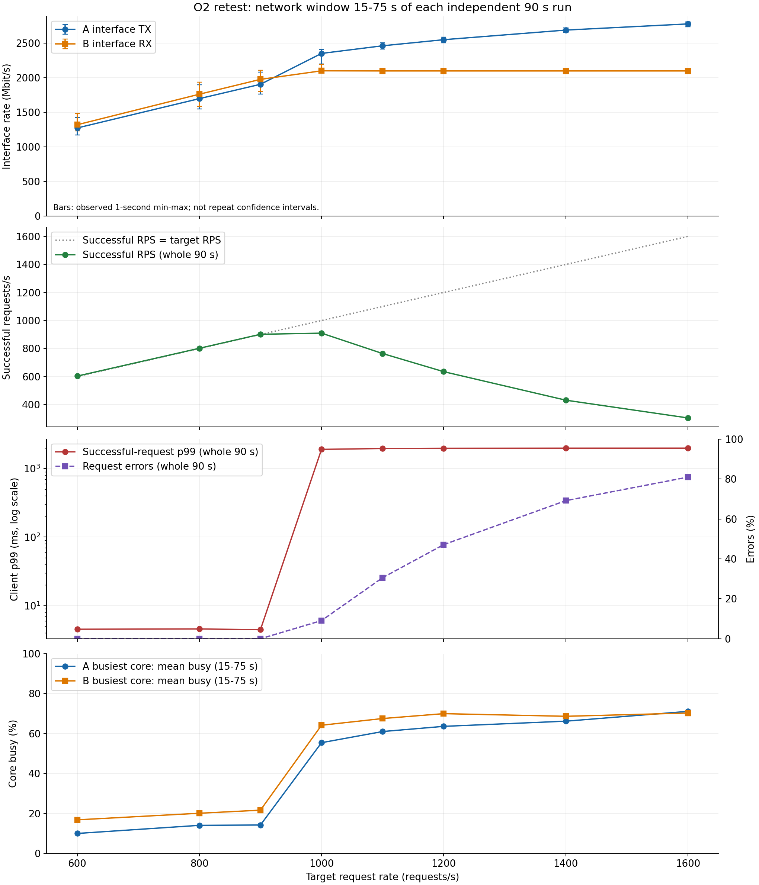
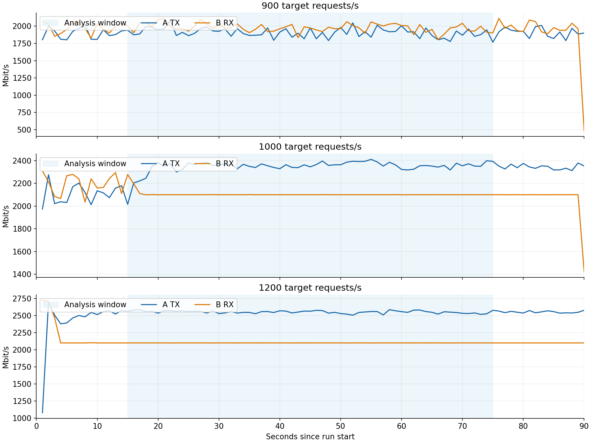

# O2 网络：90 秒独立分档复测

**本轮结论：A→B 私网路径出现约 2100 Mbit/s 的接收带宽平台，已测零错误负载提高到目标 900 RPS；尚不能将接收平台精确归因为 A 的出口限速。** 目标 1000～1600 RPS 的五个独立测试中，B 的中间一分钟接收带宽均值为 **2100.05～2101.87 Mbit/s**，加压后基本不再增加；A 的发送带宽仍由 **2353.37** 增至 **2780.22 Mbit/s**，因此不能将蓝线最高点称为 A 的持续带宽上限。网络平台、重传增多、Send-Q 积压和超时上升共同支持本轮存在网络传输能力限制。

**实验记录与测前信息。** 本轮按已明确的复测方案执行，每档 90 秒，取中间一分钟分析资源数据，原 `o2-net-02` 的预测和实测结果完整保留。本节是测后分析，不将它倒写成新的测前预测。主机及方向沿用 A（`192.168.0.178`）提供导出响应、B（`192.168.0.77`）发起下载请求；购买页面的公网 EIP 带宽不作为本次私网容量。请求路径始终是 `/api/export?kb=256`，正文大小为 262144 字节。

**实际运行条件。** 八档分别为 600、800、900、1000、1100、1200、1400、1600 RPS，每档独立启动一个 loadgen，运行 90 秒，待请求结束后空闲约 15 秒再开始下一档；整体负载时段为北京时间 **2026-11-04 12:52:19～13:06:09**。超时为 2 秒，到达过程为 poisson，loadgen 日志显示 GOMAXPROCS=2。A 的 `config-A.json` 显示监听 `0.0.0.0:8080`、GOMAXPROCS=2、Go 1.26.9；两端 `clock-*.txt` 均记录 `NTPSynchronized=yes`。本轮没有额外记录运行时二进制 SHA256，不能声称与旧实验二进制逐字节相同。

```bash
# B：每个速率独立运行；RATE 依次取 600 800 900 1000 1100 1200 1400 1600
bin/loadgen -url 'http://192.168.0.178:8080/api/export?kb=256' \
  -rates "$RATE" -step 90s -timeout 2s \
  -out "runs/o2-90s-01/steps-${RATE}.csv"
# A、B：每秒采集，设置 TZ=UTC、LC_ALL=C、S_TIME_FORMAT=ISO
sar -u -P ALL -n DEV,ETCP 1
# A：约每两秒记录一次连接状态
ss -tin state established '( sport = :8080 and dst = 192.168.0.77 )'
```

**统一统计口径。** 以 B 每个 `steps-*.csv` 的 `start_unix` 为起点，A、B 资源指标统一选取 `start+15 < 样本结束时间 <= start+75`；sar 每行表示截至该时刻的前一秒，因此这对应第 15～75 秒的 60 个完整一秒区间。每档已核验：两端 eth0 各 60 条、各核及 all 的 CPU 各 60 条、两端 ETCP 各 60 条，无缺采。时间按采集命令的 UTC 解析，CSV epoch 与监控时间对齐。取样来源与行号已在本地 `sample-index.csv` 留存；按用户选择，本轮逐秒明细和原始日志不上传 GitHub。公开汇总值见 `runs/o2-90s-01/network-summary.csv`。

客户端成功吞吐、错误率、延迟和发送滞后使用原版 loadgen 的**整档 90 秒**结果；日志没有逐请求明细，无法重算中间一分钟的请求延迟，不能将它们标成 60 秒指标。成功 RPS 用 `ok/90` 复算，避免输出列的一位小数舍入；错误率用 `(http_err+timeout+net_err)/sent`，p99 仅统计成功请求。本轮错误均为超时，未出现 dropped、HTTP 错误或连接错误。两端资源和客户端使用不同时间口径，在图例与表述中明确区分。

| 目标 RPS | 成功 RPS（90 秒） | 错误率（90 秒） | p99 ms（90 秒） | A TX Mbit/s（60 秒） | B RX Mbit/s（60 秒） |
|---:|---:|---:|---:|---:|---:|
| 600 | 603.48 | 0.00% | 4.54 | 1275.15 | 1321.80 |
| 800 | 801.92 | 0.00% | 4.58 | 1699.50 | 1763.45 |
| 900 | 901.73 | 0.00% | 4.47 | 1906.80 | 1978.11 |
| 1000 | 909.89 | 9.09% | 1905.10 | 2353.37 | 2101.87 |
| 1100 | 764.43 | 30.58% | 1960.05 | 2463.82 | 2100.08 |
| 1200 | 635.16 | 47.13% | 1975.50 | 2551.93 | 2100.05 |
| 1400 | 431.62 | 69.18% | 1981.57 | 2691.12 | 2100.06 |
| 1600 | 304.84 | 80.95% | 1983.30 | 2780.22 | 2100.14 |

**资源与传输证据。** CPU busy 按 `100−%idle−%iowait−%steal` 计算，最忙核均值取各逻辑核窗口均值中的最大值，不将进程 CPU 的单核 100% 口径误作整机容量。A 重传为 sar 的全机 TCP 重传报文段速率，不是 HTTP 错误率；ss 仅汇总 A:8080 与 B 的连接 Send-Q，每档有 29～30 个快照，取各快照总 Send-Q 的最大值。Send-Q 包含未发送或未确认的字节，不等于 HTTP 在途请求数；没有跨快照累加连接生命周期内的重传计数。

| 目标 RPS | A 最忙核均值（60 秒） | B 最忙核均值（60 秒） | A 重传 段/秒（60 秒） | Send-Q 快照最大合计 MiB | 发送滞后 p99 ms（90 秒） |
|---:|---:|---:|---:|---:|---:|
| 600 | 9.97% | 16.79% | 278.95 | 0.48 | 1.06 |
| 800 | 14.03% | 20.09% | 360.23 | 0.63 | 1.05 |
| 900 | 14.21% | 21.64% | 420.52 | 0.26 | 1.05 |
| 1000 | 55.43% | 64.17% | 22057.25 | 127.14 | 0.96 |
| 1100 | 61.02% | 67.53% | 31953.43 | 150.55 | 0.73 |
| 1200 | 63.61% | 69.97% | 39479.73 | 133.08 | 0.57 |
| 1400 | 66.20% | 68.65% | 50791.32 | 98.07 | 0.39 |
| 1600 | 71.12% | 70.27% | 57782.06 | 113.96 | 0.42 |

**如何判断上限。**

1. 600～900 RPS 时成功吞吐跟随实际到达率，均为零错误，p99 约 4.5 ms；目标 900 RPS 实际成功 **901.73 RPS**，是本轮已测点中的最高零错误负载。泊松到达存在随机波动，因此成功 RPS 可略高于目标值；不能把 900 称为精确的极限，900～1000 之间仍未细扫。
2. 1000 RPS 时成功吞吐仅小幅增至 **909.89 RPS**，错误率升至 **9.09%**、p99 **1905.10 ms**；A 重传从 900 档约 **420.52** 增至 **22057.25 段/秒**，Send-Q 最大合计从约 **0.26** 增至 **127.14 MiB**，B 接收进入约 **2100 Mbit/s** 平台。再加压至 1600 RPS，B 接收平台基本不动，成功吞吐降至 **304.84 RPS**、超时率达 **80.95%**。这说明带宽利用不能等同于有效业务吞吐，失败及部分响应、重传也在消耗资源。
3. 饱和拐点的 1000 档，A/B 最忙核均值为 **55.43% / 64.17%**，单秒单核最高为 **63.79% / 69.47%**，未显示持续 CPU 用满；发送滞后 p99 为 **0.96 ms**，未出现发送滞后警告。结合稳定接收平台及重传、Send-Q 突增，证据支持优先考虑网络路径能力。更高负载 CPU 开销随重传和连接数上升，1100 档 A 有一次单秒单核 100% 样本；不能据均值不满就宣称完全排除了 CPU 瞬时影响。各阶段可见 steal 均值为 0，也不等于排除了平台侧全部干扰。
4. A TX 高于 B RX 不可直接换算为丢包率：虚拟网卡计数位置、分段/聚合、重传和其他流量会影响可比性。低负载下两端计数也有差异；本轮以独立的 TCP 重传和队列证据辅助解释，不能仅凭差值认定所有额外流量都在路径中丢失。

**带宽资源账与成立条件。** 每请求成功正文为 `256×1024×8=2097152 bit`，正文带宽需求为 `目标 RPS×2.097152 Mbit/s`；网卡带宽为 `平均 txkB/s 或 rxkB/s×1024×8/1000000`。B 接收平台约 2100 Mbit/s，若所有容量都可用于不重传的响应正文，理想换算约 `2100/2.097152≈1001.36 RPS`；这只是量纲换算，不是可用容量承诺。实际平台包含计数口径、协议及失败传输等影响，1000 档成功正文吞吐为 **1908.18 Mbit/s**，已有 9.09% 超时；900 档成功正文吞吐约 **1891.07 Mbit/s**，且没有错误。不能据平台直接宣称“约 1000 RPS 全部成功”。

本轮测得的是当前两机、该方向、256 KiB 响应及 2 秒超时下的路径平台；A TX 本身仍上升，没有测出明确的 A 网卡发送平台。要将约 2100 Mbit/s 精确归因于 A 出口或 B 入口 QoS，还需平台侧方向带宽/限流监控，或使用接收能力更高的第三台主机作对照。本轮各速率仅测试一次，没有重复试验的置信区间；图中的范围是窗口内一秒数据的 min～max。旧实验与本轮差异如实保留，不能混合两次数据计算同一个阶段。



图中网络及 CPU 取第 15～75 秒；成功吞吐、p99 和错误率取整档 90 秒。已移除未独立验证适用本轮的固定规格上限线；成功吞吐另列一格，避免与网卡吞吐混淆。



逐秒图显示 1000 档 B RX 在约第 17 秒后稳定于平台，1200 档更早进入平台；900 档则随实际到达流量波动，未呈现同样的平顶。1000 档所选窗口仍包含很短的进入平台过程，已保留其逐秒范围，未挑选只支持结论的样本。

**归档与发布范围。** 按用户选择，GitHub 本轮仅新增本节报告、独立 README、两张图的 PNG/SVG 版本及 `network-summary.csv`；不上传本轮原始监控日志、配置文件、逐秒明细或采样索引。22 个原始文件已下载到本地，原件仍留在各实验服务器；本地另存 SHA256 清单和复算脚本，已核验每档采样数、客户端计数及原始文件完整性。原始 `ss-A.log` 为 239859419 字节，本地采用无损 gzip 留存并核验了解压后的 SHA256。公开汇总表属于派生结果，不能替代实验验收所需的原始证据；需要核验时应从保留的原始文件复算。安全组临时 8080 规则的删除状态本次未独立核验，不据此声称已完成清理。
